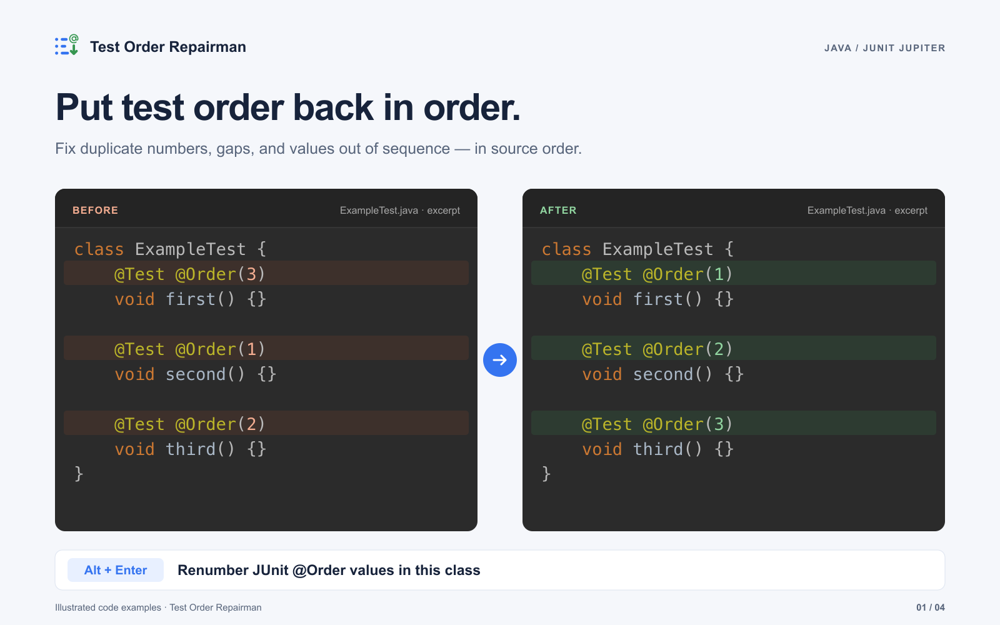
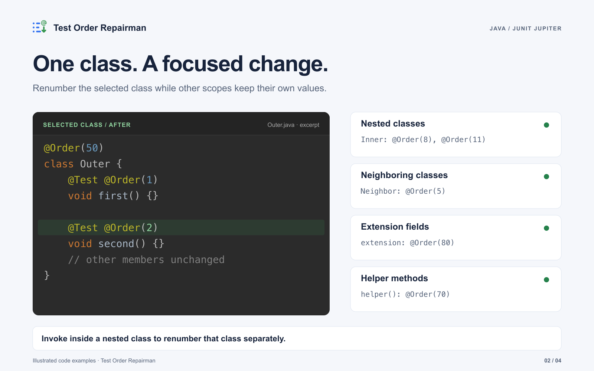
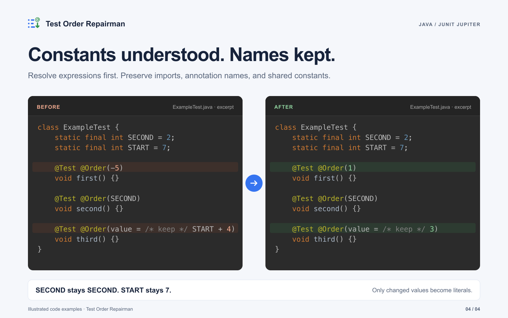

<picture>
  <source media="(prefers-color-scheme: dark)" srcset="src/main/resources/META-INF/pluginIcon_dark.svg">
  
</picture>

# Test Order Repairman

**Renumber JUnit `@Order` values with Alt+Enter.**

Added a test, moved a method, or ended up with duplicate numbers? Assign consecutive
values in source order without moving your test methods.

[Marketplace](https://plugins.jetbrains.com/plugin/23151-test-order-repairman) ·
[Getting started](#usage) ·
[Report an issue](https://github.com/vlaslaptev/test-order-repairman/issues) ·
[MIT license](LICENSE)



## Usage

1. Open a Java class containing JUnit Jupiter test methods annotated with `@Order`.
2. Place the caret inside one of those `@Order` annotations.
3. Press **Alt+Enter** and choose **Renumber JUnit @Order values in this class**.

For example:

```java
import org.junit.jupiter.api.MethodOrderer;
import org.junit.jupiter.api.Order;
import org.junit.jupiter.api.Test;
import org.junit.jupiter.api.TestMethodOrder;

@TestMethodOrder(MethodOrderer.OrderAnnotation.class)
class ExampleTest {
    @Test @Order(3)
    void first() {}

    @Test @Order(1)
    void second() {}

    @Test @Order(2)
    void third() {}
}
```

After the intention, these values are `1`, `2`, and `3`. The methods stay in
their original locations. Numbering starts at 1, including a single annotated method.

JUnit's `MethodOrderer.OrderAnnotation` controls execution order. Configure it with
`@TestMethodOrder` as above, or through the equivalent JUnit default orderer.

## A focused change

- Renumber already annotated test methods declared directly in the selected class.
- Keep neighboring classes, nested classes, class annotations, extension fields,
  helper methods, and methods without `@Order` unchanged.
- Invoke inside a nested class to process that class separately.
- Support regular, repeated, and parameterized tests, test factories, templates,
  and composed test annotations.



## Constants and expressions

Integer constants, constant expressions, and negative values are evaluated before
any edits. A changed expression becomes an integer literal; shared declarations
are never edited. Values that already match their position keep their original
expression. Annotation names, imports, and the `value =` form are preserved.



The action is unavailable if numbering already matches, or a participating order
value is invalid, unresolved, or incomplete, or a method has duplicate `@Order`
annotations. This prevents a partially renumbered class. Wait for IDE indexing to complete if references cannot yet resolve.

## Compatibility

| Area | Declared support for version 1.2 |
| --- | --- |
| IDE | IntelliJ IDEA 2021.3.3–2023.2.x with Java support |
| Platform build | `213.7172.25` through `232.*` |
| Runtime target | Java 11 |
| Source language | Java |
| Test framework | JUnit Jupiter |

The intention is invoked manually. It does not watch edits, move methods, add missing
annotations, or configure the JUnit orderer. JUnit 4 and Kotlin intentions are not
implemented. Newer IDE compatibility is not claimed by this update.

## Release and media

Version 1.2 includes the scoped renumbering fixes, the annotation logo, and the
updated media. Publication is pending Marketplace submission and approval. See the [changelog](CHANGELOG.md).

The gallery consists of original informational illustrations derived from repository
fixtures, not screenshots of a running plugin. Editable sources, upload order,
copy, and reproduction instructions are in the [Marketplace kit](docs/marketplace/README.md).
